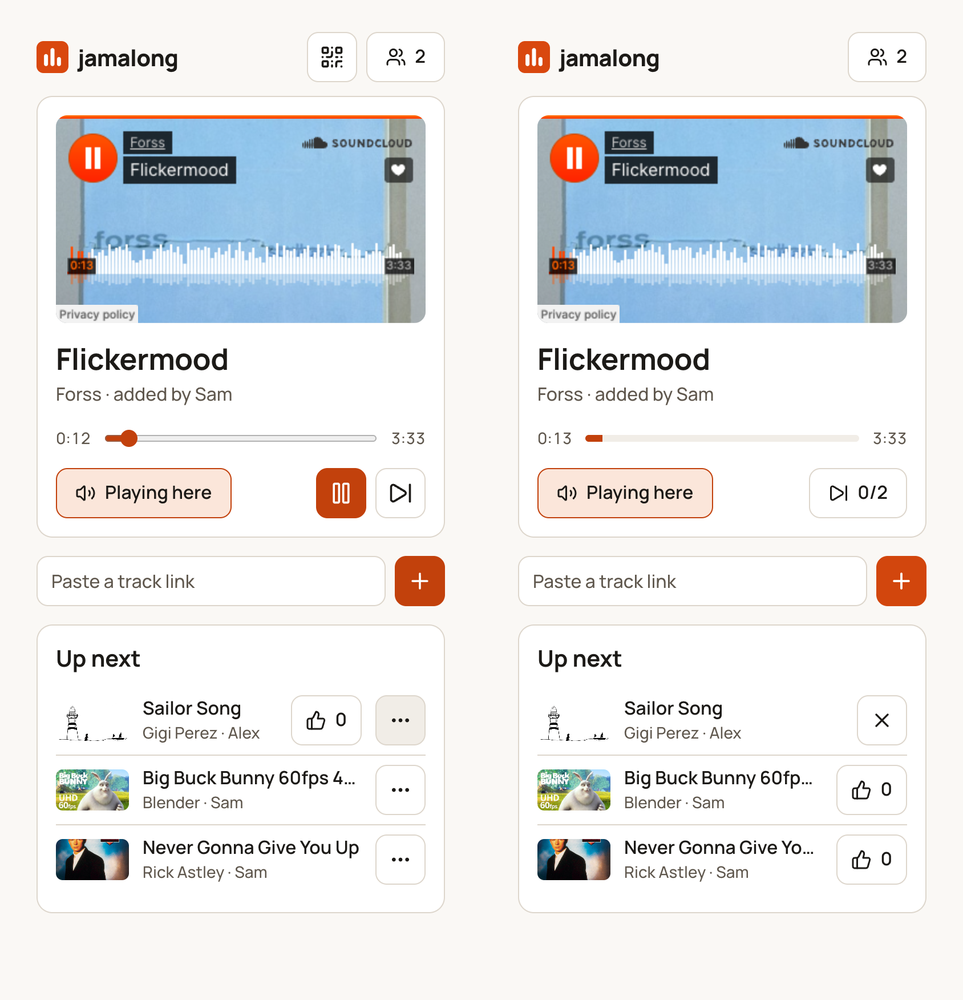
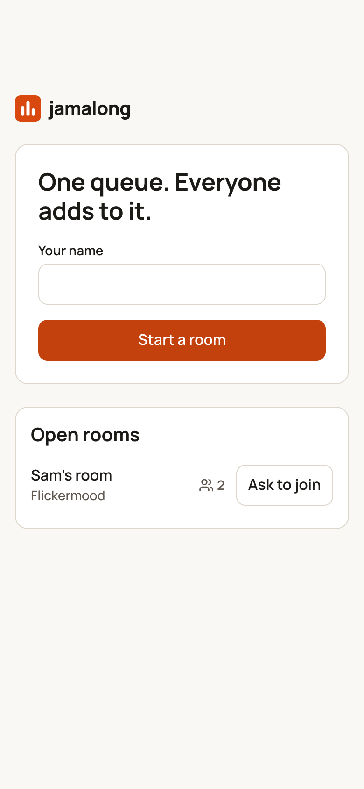
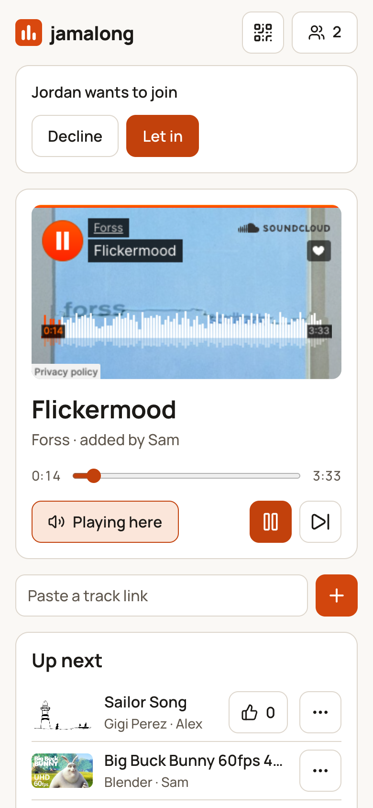
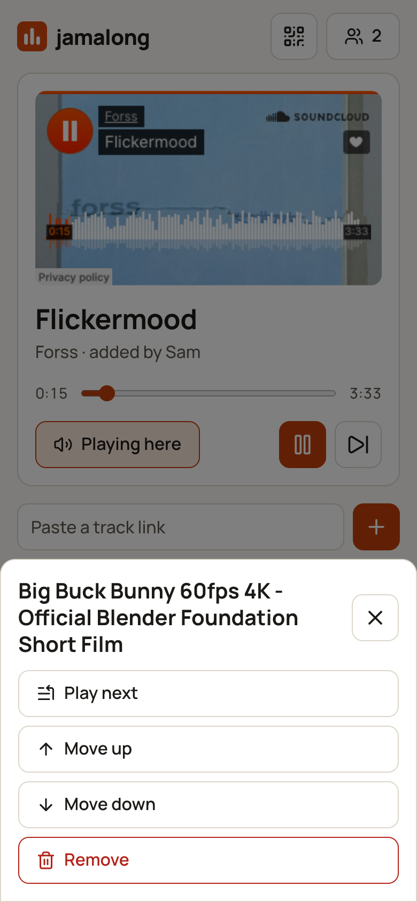

<p align="center">
  <h1 align="center">jamalong</h1>
  <p align="center">
    Group listening rooms with one shared queue, across Spotify, SoundCloud and YouTube.
    <br /><br />
    <a href="#installation">Install</a>
    &middot;
    <a href="https://github.com/urmzd/jamalong/issues">Report Bug</a>
    &middot;
    <a href="#quick-start">Quick Start</a>
  </p>
</p>

<p align="center">
  <a href="https://github.com/urmzd/jamalong/actions/workflows/ci.yml"></a>
  &nbsp;
  <a href="LICENSE"></a>
</p>

<p align="center">
  <picture>
    <source media="(prefers-color-scheme: dark)" srcset="showcase/demo-dark.png">
    
  </picture>
</p>
<p align="center"><em>The real app in headless Chrome: a host and a guest, each playing the room on their own device. Not edited.</em></p>

## Features

- **One queue for everyone.** Paste a Spotify, SoundCloud or YouTube track link. The server orders every change and every device follows it.
- **No account, no install.** Join from a link or a QR code, or find the room under **Open rooms** and ask the host to let you in.
- **Play on one device or many.** Tap **Play here** on any device. One speaker is a party; several speakers stay on one clock, so friends in different places hear the same moment.
- **Your login stays yours.** Each speaker plays inside the provider's own player, signed in to its own account. jamalong stores no provider tokens and never relays audio.
- **Fair by default, in your hands when needed.** Tracks take turns by person and votes break ties. The host and collaborators can play a track next or move it.
- **Three roles.** The host controls everything, collaborators control playback and the queue, guests add, vote and vote to skip.

<p align="center">
  <picture>
    <source media="(prefers-color-scheme: dark)" srcset="showcase/open-rooms-dark.png">
    
  </picture>
  &nbsp;
  <picture>
    <source media="(prefers-color-scheme: dark)" srcset="showcase/join-request-dark.png">
    
  </picture>
  &nbsp;
  <picture>
    <source media="(prefers-color-scheme: dark)" srcset="showcase/queue-actions-dark.png">
    
  </picture>
</p>
<p align="center"><em>Open rooms &middot; Ask to join &middot; Play next and reorder</em></p>

## Installation

### Prerequisites

| Requirement | Version |
| ----------- | ------- |
| Go          | 1.27    |
| Node        | 24      |
| pnpm        | 11      |

### Build

```bash
git clone https://github.com/urmzd/jamalong
cd jamalong
pnpm install
pnpm run build
make build
```

This builds the web app into `web/dist` and the server into `bin/jamalong`.

## Quick Start

```bash
./bin/jamalong -web web/dist
```

1. Open http://127.0.0.1:8080, enter your name and tap **Start a room**.
2. Tap **Play here** on the device that should make sound.
3. Paste a track link into **Paste a track link**.
4. Share the room: tap the QR button and **Copy link**, or let people find it under **Open rooms**.

## Usage

### Providers

Paste a link to a single track. Album and playlist links are not supported yet.

| Provider   | Link forms                                                         | What a speaker hears                                                                |
| ---------- | ------------------------------------------------------------------ | ----------------------------------------------------------------------------------- |
| Spotify    | `open.spotify.com/track/...`, `spotify:track:...`                  | The full track when the browser is signed in to Spotify, a 30-second preview if not |
| SoundCloud | `soundcloud.com/artist/track`, `on.soundcloud.com/...` share links | The full track for public tracks, a preview for Go+ tracks                          |
| YouTube    | `youtube.com/watch`, `youtu.be`, `music.youtube.com`, Shorts       | The video, unless its owner blocks playback on other sites                          |

Safari blocks the cookies the Spotify player needs, so Spotify may play previews there even when signed in.

### Playing together

A device makes sound only after someone taps **Play here** or **Play** on it, because browsers refuse sound without a tap. If no device is playing, the room pauses.

- **Same place:** turn on one speaker. Every other phone is a remote.
- **Different places:** each person turns on their own device. jamalong keeps them on one clock.

### Sharing over the internet

Serve jamalong over HTTPS, through a reverse proxy or a tunnel, and pass `-secure-cookies`. YouTube refuses many music videos on a plain `http://127.0.0.1` page, and plays them over HTTPS.

Rooms live in memory. Restarting the server ends every room.

## Configuration

| Flag              | Default          | Effect                                                        |
| ----------------- | ---------------- | ------------------------------------------------------------- |
| `-addr`           | `127.0.0.1:8080` | Address to listen on                                          |
| `-web`            | empty            | Directory of the built web app. Empty serves the API only     |
| `-secure-cookies` | `false`          | Mark session cookies Secure. Set it when serving behind HTTPS |

The server logs every room event to stderr: joins, speakers, adds, skips, and the cause of each track change.

## Development

Run the server and the web app side by side. Vite serves the app on port 5173 and proxies the API to the Go server.

```bash
./bin/jamalong
pnpm run dev
```

| Task         | Go           | Web              |
| ------------ | ------------ | ---------------- |
| Test         | `make test`  | `pnpm test`      |
| Lint         | `make lint`  | `pnpm run lint`  |
| Format       | `make fmt`   | `pnpm run fmt`   |
| Quality gate | `make check` | `pnpm run check` |

## Documentation

- [Contributing](CONTRIBUTING.md)
- [Security policy](SECURITY.md)
- [Code of conduct](CODE_OF_CONDUCT.md)
- [AGENTS.md](AGENTS.md)

## License

[Apache-2.0](LICENSE)
